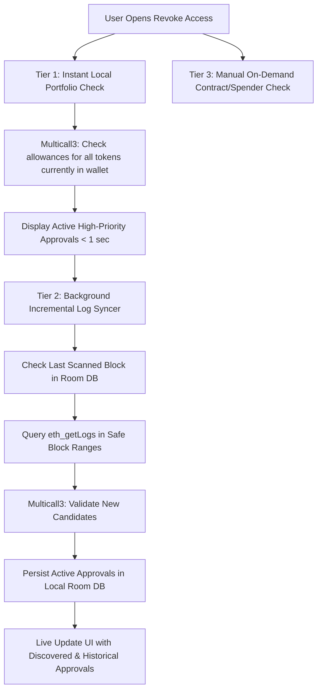

> Status: Historical prototype research and proposals. Some implementation details predate the current scanner; see RELEASE_NOTES.md for current public behavior.

# OpenSwap Architecture Research: Robust Revoke Approval Tool

## 1. Executive Summary

A **Revoke Approval (Allowance Manager)** tool protects cryptocurrency wallet users from unauthorized token theft caused by malicious smart contracts, protocol compromises, or lingering "infinite approvals" (`type(uint256).max`).

In this codebase (`openswap`, an open-source Android multi-chain wallet forked from Unstoppable Wallet / `bankwallet`), a foundational prototype has been drafted across `walletkit` and `walletkit-chain-evm`. This research evaluates:
1. **Industry standards & commercial wallet designs** (SafePal, Rabby, Revoke.cash, MetaMask).
2. **Current state of OpenSwap's prototype** (`EvmApprovalAccessService`, `ApprovalAbi`, `ApprovalAccessPage`, `ApprovalRevokePage`).
3. **Core technical limitations & bottlenecks** of the prototype (e.g., pure RPC `eth_getLogs` vs. indexing, serial `eth_call` overhead, lack of persistence, missing spender recognition).
4. **Concrete implementation architecture** to turn OpenSwap's revoke tool into a production-grade, privacy-preserving, high-performance feature.

---

## 2. Smart Contract Allowance Mechanics & Standards

### 2.1 ERC-20 Allowances
* **Approval ABI**:
  ```solidity
  function approve(address spender, uint256 amount) external returns (bool);
  ```
  Selector: `0x095ea7b3`
* **Allowance Check**:
  ```solidity
  function allowance(address owner, address spender) external view returns (uint256);
  ```
  Selector: `0xdd62ed3e`
* **Revocation Call**:
  Call `approve(spender, 0)` on the token contract.
* **Edge Cases & Quirks**:
  * **USDT (Tether) Two-Step Approval Requirement**: On Ethereum mainnet, USDT reverts if attempting to set a non-zero allowance when a non-zero allowance already exists. However, setting to `0` is always accepted.
  * **Non-Standard Return Values**: Tokens like USDT (legacy ERC-20) return `void` (0 bytes) rather than `bool` (32 bytes). Safe ERC-20 decoders must accept empty return data on success.
  * **Decimals & Unit Formatting**: Allowances are returned in raw smallest units (`uint256`). Without fetching `decimals()`, the UI cannot format the true token amount.

### 2.2 ERC-721 (NFT) Permissions
* **Single NFT Approval**:
  * `approve(address to, uint256 tokenId)` (Selector: `0x095ea7b3`).
  * Check: `getApproved(uint256 tokenId)` (Selector: `0x081812fc`) AND `ownerOf(uint256 tokenId)` (Selector: `0x6352211e`).
  * Revoke: `approve(address(0), tokenId)`.
  * *Critical Gotcha*: When an NFT is transferred, the single-token approval is cleared on-chain by the ERC-721 contract without emitting a separate `Approval(owner, 0, tokenId)` log. Therefore, verification MUST check both current ownership and approved address.
* **Collection-Wide Operator Approval**:
  * `setApprovalForAll(address operator, bool approved)` (Selector: `0xa22cb465`).
  * Check: `isApprovedForAll(address owner, address operator)` (Selector: `0xe985e9c5`).
  * Revoke: `setApprovalForAll(operator, false)`.

### 2.3 ERC-1155 (Multi-Token) Permissions
* ERC-1155 tokens use the identical collection-wide operator mechanism:
  * `setApprovalForAll(address operator, bool approved)` (Selector: `0xa22cb465`).
  * Check: `isApprovedForAll(address owner, address operator)` (Selector: `0xe985e9c5`).
  * Revoke: `setApprovalForAll(operator, false)`.

### 2.4 Permit2 & Off-Chain Signatures (EIP-2612 / Uniswap Permit2)
* **Permit2 Pattern**: Canonical Permit2 contract (`0x000000000022D473030F116dDEE9F6B43aC78BA3`) holds an infinite ERC-20 approval, while individual dApps receive time-limited, signed EIP-712 permits.
* **Revocation Strategy**:
  1. Revoking the root ERC-20 allowance granted to the Permit2 contract instantly disables all active and future permits on that token.
  2. Permit2 contract functions can also be called directly (`lockdown(...)` or `approve(token, spender, 0, expiration)`).

---

## 3. Comparison of Approval Discovery Approaches

How wallets like SafePal, Rabby, and Revoke.cash discover approvals vs. OpenSwap's pure RPC approach:

| Capability | Pure RPC (`eth_getLogs`) (Current Prototype) | Centralized / Indexer API (SafePal / Revoke.cash) | Hybrid Multi-Tier Architecture (Recommended) |
| :--- | :--- | :--- | :--- |
| **Privacy** | **100% Private**: Queries direct node; Tor compatible; no address telemetry. | **Leaked**: Transmits user addresses to third-party indexer servers. | **Configurable**: Fast local/RPC discovery first, with opt-in indexed queries. |
| **Discovery Speed** | **Slow**: Minutes to query historical blocks backwards in 24-chunk increments. | **Instantaneous**: Sub-second response from indexed database. | **Fast**: Instant check of current token balances + background incremental log sync. |
| **Historical Completeness** | **Truncated**: Public nodes cap log queries (e.g., 2,000–10,000 blocks); scanning 20M blocks is infeasible. | **Complete**: Complete history from genesis block. | **High**: Complete for held assets; deep-block historical logs synced incrementally and cached. |
| **External Dependencies** | Node RPC only. | Relies on vendor API availability and API rate limits. | Resilient: Falls back smoothly to direct RPC. |
| **Network Support** | Any EVM network configured in the wallet. | Only networks supported by the indexer provider. | Full compatibility with all custom and native EVM networks. |

---

## 4. Assessment of OpenSwap's Prototype Code

The current prototype in `walletkit` and `walletkit-chain-evm` has several solid security principles already in place, but also significant bottlenecks:

### Strengths
1. **Zero-Value Allowlisted Calldata (`ApprovalAbi.kt`)**: Calldata for revoking is strictly generated in pure Kotlin (`approve(spender, 0)` or `setApprovalForAll(operator, false)`) without relying on remote or untrusted ABI encoders.
2. **Tor Network Awareness (`EvmApprovalAccessService.kt`)**: Enforces Tor routing when enabled, rejecting HTTP redirects to avoid address disclosure.
3. **Session Re-Verification**: Re-verifies allowance state and active account at transaction signing time to avoid signing stale transactions.
4. **Integration with Existing Transaction Pipeline**: Uses OpenSwap's `SendTransactionServiceFactory` and `ConfirmTransactionScreen` for gas estimation and EIP-1559 fee calculation.

### Architectural Limitations & Bugs to Resolve
1. **RPC `eth_getLogs` Scan Limits**:
   - `EvmApprovalAccessService.scan` queries backwards from `head` with a request cap of 24. On chains like Arbitrum, Base, or Polygon with tens of millions of blocks, 24 requests of 2,000–10,000 blocks cover less than 1% of the chain history.
   - Users may falsely assume their wallet is clean when older approvals were simply never reached.
2. **Serial `eth_call` Allowance Checks**:
   - For every candidate discovered, `check(rpc, candidate)` executes a separate synchronous HTTP `eth_call`. If 50 candidates are found, this performs 50–100 individual network requests, causing UI freezing or timeouts.
3. **Lack of Persistence (Room DB)**:
   - All scan state is held in an in-memory `candidates = linkedMapOf<String, ApprovalTarget>()`. Navigating back or rotating the screen discards all scan results, forcing the user to re-scan from scratch.
4. **Missing Token Metadata & Spender Resolution**:
   - Displays raw contract and spender addresses (`0x1111...`, `0x2222...`) without symbol, token decimals, logo, or protocol name (e.g., "Uniswap V3 Router", "OpenSea").
   - Does not display the real token value at risk (USD value).

---

## 5. Blueprint for a Robust Revoke Tool in OpenSwap

### 5.1 Discovery Optimization: Tiered Approvals Engine



#### Tier 1: Instant Portfolio Balance Check (Multicall3)
Most dangerous approvals exist on tokens the user currently holds.
- Query user's current token holdings from `App.walletManager.activeWallets`.
- For each token, query allowances against a curated list of top EVM protocols (Uniswap, 1inch, PancakeSwap, SushiSwap, OpenSea, etc.) via a single `Multicall3.aggregate3` call.
- Delivers an instantaneous list of active permissions within 500ms of opening the page.

#### Tier 2: Incremental RPC Log Scanner with Room Persistence
- Store scanned block height and discovered permissions in local Room database (`ApprovalDao`).
- Only scan new blocks since the last recorded height when the wallet opens.
- Adaptively shrink range on RPC errors (e.g., Infura 10k block cap -> binary reduction to 5k -> 2.5k).

---

### 5.2 Multicall3 Batching Implementation

Using canonical Multicall3 contract (`0xcA11bde05977b3631167028862bE2a173976CA11` deployed at the identical address across 100+ EVM networks):

```kotlin
data class Call3(val target: String, val allowFailure: Boolean, val callData: ByteArray)
data class Result(val success: Boolean, val returnData: ByteArray)

// Query multiple allowances and token balances in a single HTTP POST:
suspend fun batchCheckAllowances(
    rpc: Rpc,
    owner: String,
    targets: List<ApprovalTarget>
): List<ActiveApproval> {
    val calls = targets.map { target ->
        val callData = when (target.kind) {
            ApprovalKind.Token -> ApprovalAbi.encodeAllowanceCall(owner, target.spender)
            ApprovalKind.NftCollection -> ApprovalAbi.encodeIsApprovedForAllCall(owner, target.spender)
            ApprovalKind.Nft -> ApprovalAbi.encodeGetApprovedCall(target.tokenId!!)
        }
        Call3(target.contract, allowFailure = true, callData)
    }
    val results = executeMulticall3(rpc, calls)
    return parseMulticallResults(targets, results)
}
```

---

### 5.3 Spender Directory & Risk Engine

A robust tool must contextualize permissions so users make informed decisions:

1. **Known Spender Labeling**:
   - Embed an offline JSON / Room table mapping known spender contracts:
     - `0x68b3465833fb72A70ecDF485E0e4C7bD8665Fc45` -> "Uniswap V3: SwapRouter02" (Verified Protocol)
     - `0x111111125421ca6dc452d289314280a0f8842a65` -> "1inch v5: Aggregator Router" (Verified Protocol)
     - `0x000000000022D473030F116dDEE9F6B43aC78BA3` -> "Uniswap Permit2" (Verified Core Contract)
2. **Risk Classification**:
   - **Critical / Danger**:
     - Spender marked as malicious in scam / drainer blacklists.
     - Known phishing contract or unverified contract requesting unlimited token balance.
   - **Warning / Medium**:
     - Unlimited allowance (`amount == 2^256 - 1`) on an inactive or non-whitelisted protocol.
     - NFT collection-wide operator permission (`setApprovalForAll = true`).
   - **Low**:
     - Limited allowance matching a specific trade on a reputable, verified DEX router.
3. **Value at Risk (VaR)**:
   - Calculate real asset exposure using `MarketKit`:
     $$\text{Exposed Amount} = \min(\text{Allowance}, \text{Current Wallet Balance})$$
     $$\text{VaR (USD)} = \text{Exposed Amount} \times \text{Token Price (USD)}$$
   - Sort the approval list by VaR (USD) in descending order to surface the highest financial risks first.

---

### 5.4 Transaction Execution & Batch Revoke UX

1. **Non-Standard Token Support**:
   - Handle tokens that do not return a boolean (like mainnet USDT) by checking transaction success status rather than decoding a 32-byte boolean return value.
2. **Re-Verification Gate**:
   - Before submitting the revoke transaction, execute a fast `eth_call` check. If the allowance was already set to 0 in another transaction or wallet, notify the user immediately and avoid wasting network gas fees.
3. **Batch Revocation Queue**:
   - When users select 5 or 10 permissions to revoke:
     - Provide a sequential transaction runner that signs and broadcasts transactions with incremented nonces (`nonce`, `nonce + 1`, ...).
     - Display clear per-transaction progress in Compose UI (e.g., "Revoking 2 of 5: USDT on 1inch...").

---

## 6. Implementation Action Plan for OpenSwap

### Phase 1: Engine Core & Batching
* [ ] Add `Multicall3` contract caller to `walletkit-chain-evm` for batched allowance queries.
* [ ] Handle USDT zero-allowance semantics and non-boolean ERC-20 return values.
* [ ] Integrate token symbol, decimals, and icon resolution via `App.marketKit.token(...)`.

### Phase 2: Local Persistence
* [ ] Create `ApprovalRecord` Room entity and `ApprovalDao` in `walletkit` database.
* [ ] Persist verified approvals and scan progress (`lastScannedBlock`) keyed by `(accountId, blockchainType)`.
* [ ] Allow instant cache loading when the user opens the "Revoke Access" page.

### Phase 3: Spender Directory & Risk Assessment
* [ ] Integrate an offline verified router database (`known_spenders.json`).
* [ ] Compute Value at Risk (USD) using live token prices from `MarketKitWrapper`.
* [ ] Add risk severity tags (`Critical`, `Warning`, `Standard`) to UI list items.

### Phase 4: UI/UX Refinement
* [ ] Filter tabs: "All", "Tokens (ERC-20)", "NFTs (ERC-721/1155)", "Unlimited Only".
* [ ] Sort by: "Highest Value at Risk", "Recently Approved", "Alphabetical".
* [ ] Batch revoke execution with sequential nonce management and clear progress tracking.
